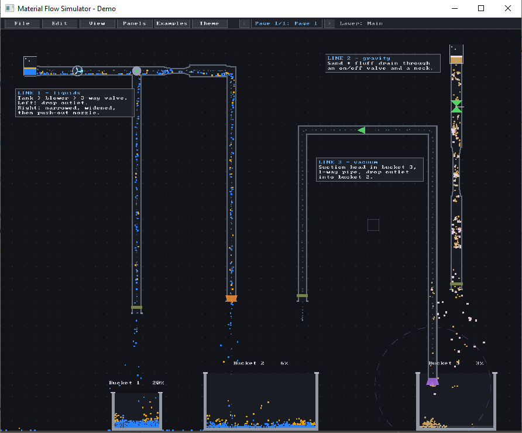
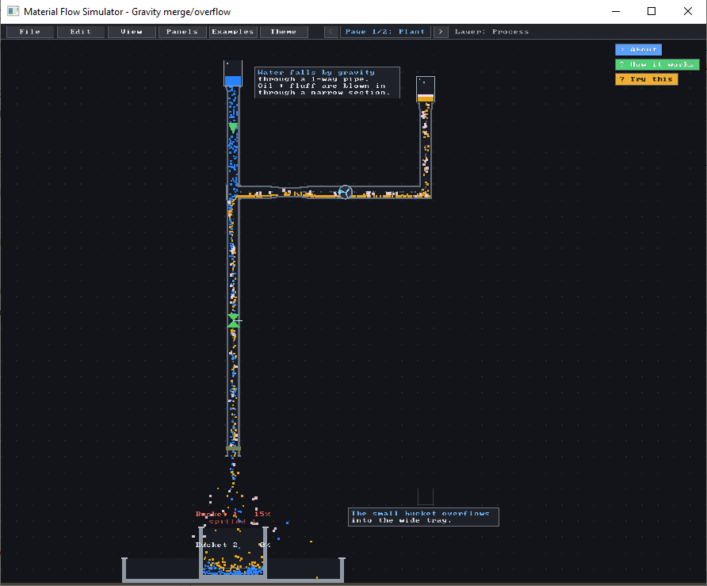
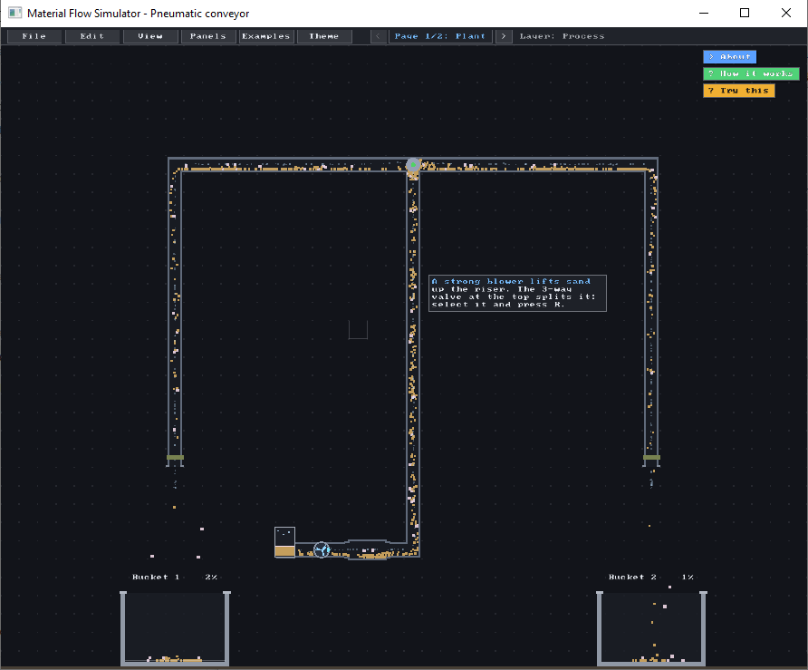
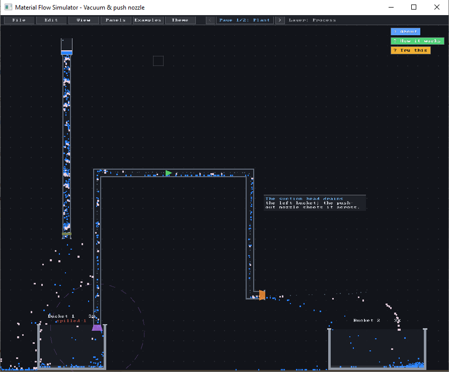
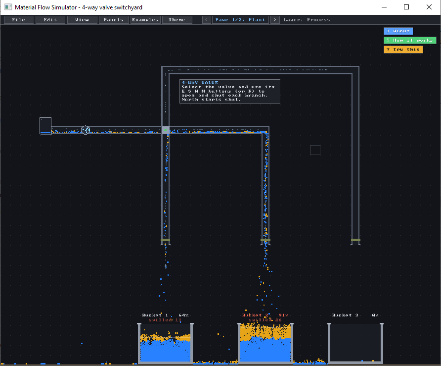
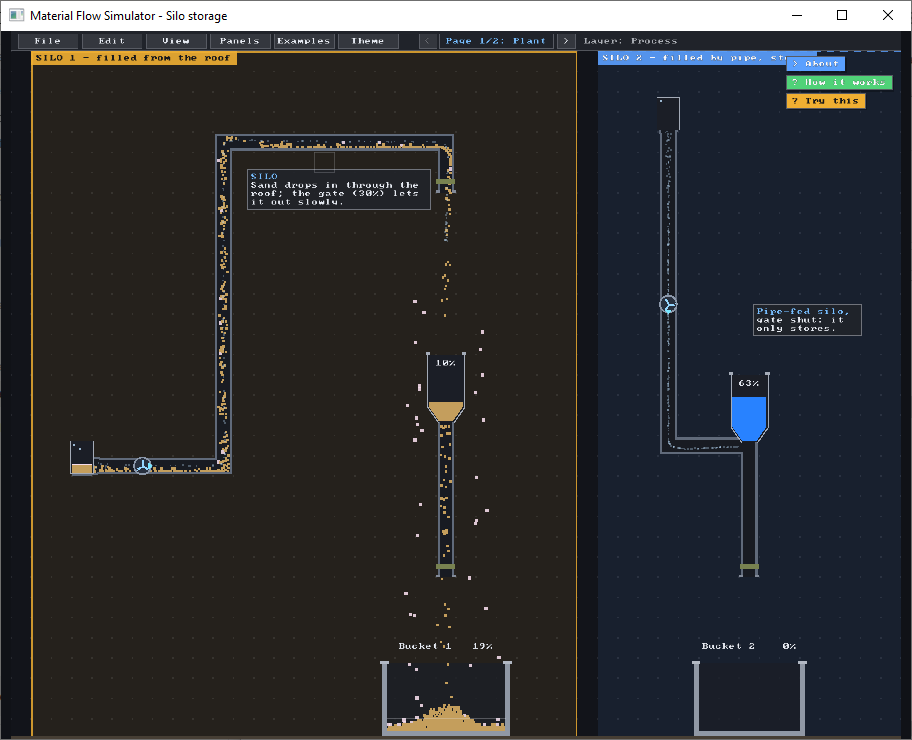

# Material-flow-simulation-SDL3-LazarusIDE
Material flow simulation SDL3 LazarusIDE

 

 

 

Lazarus-SDL-3.0-Package: https://github.com/sechshelme/Lazarus-SDL-3.0-Packages-and-Examples

https://github.com/libsdl-org

https://github.com/libsdl-org/SDL/releases

https://github.com/libsdl-org/SDL_image/releases

https://github.com/libsdl-org/SDL_mixer/releases

https://github.com/libsdl-org/SDL_ttf/releases
